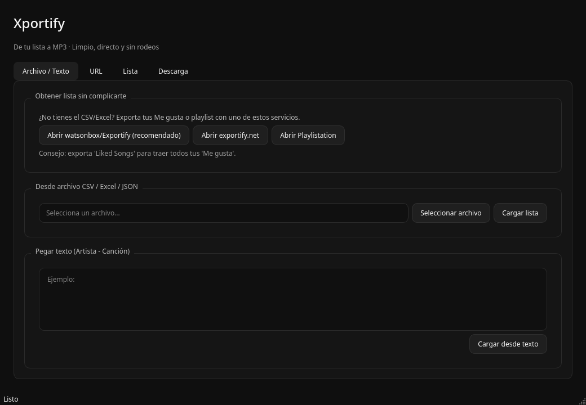
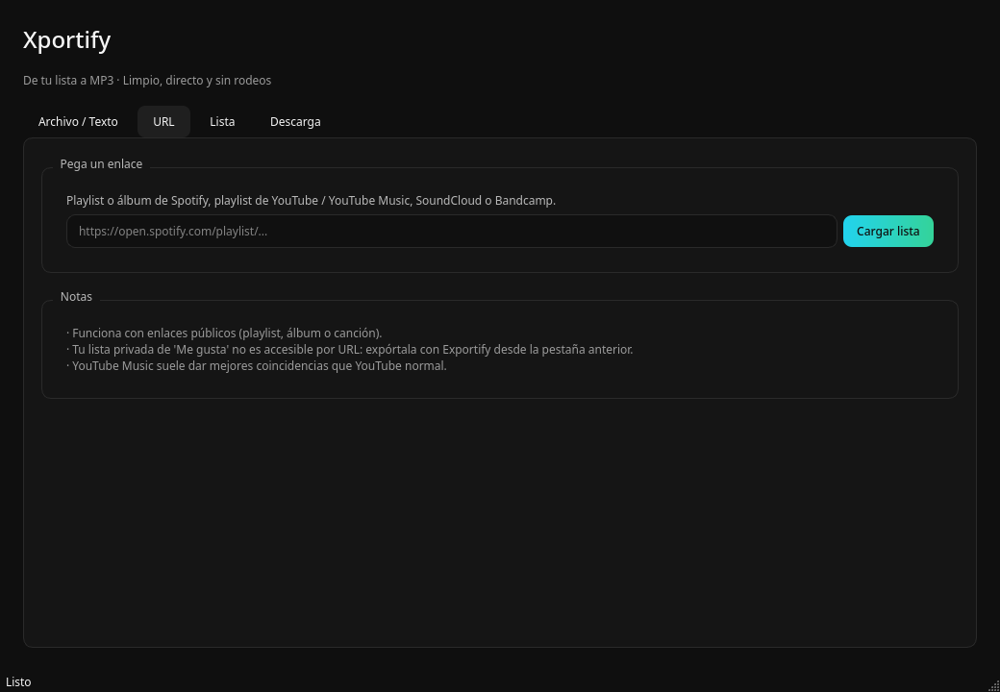
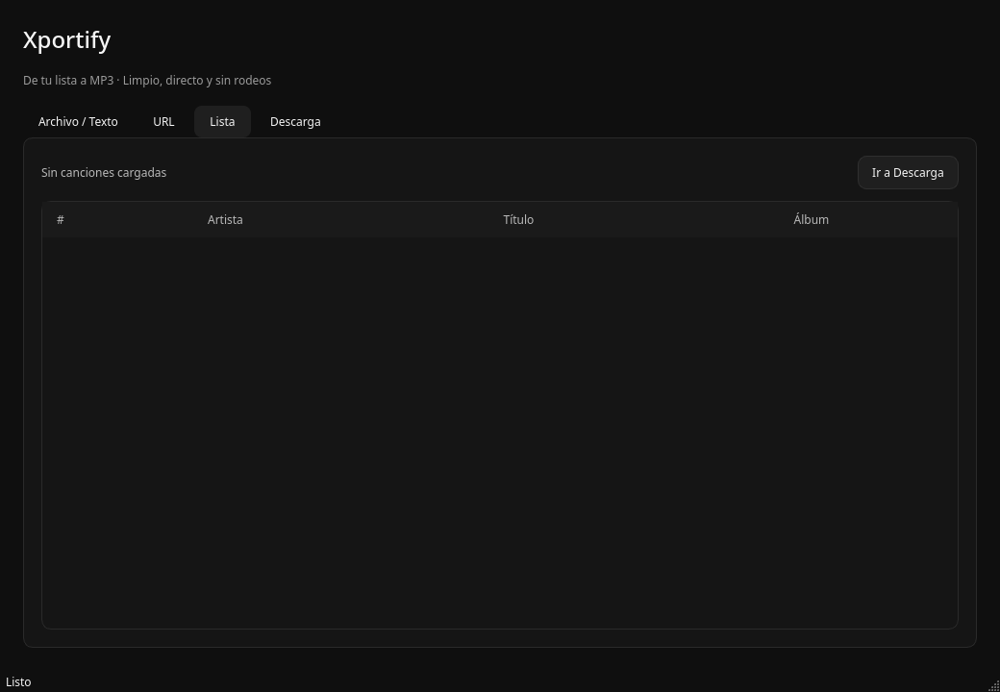
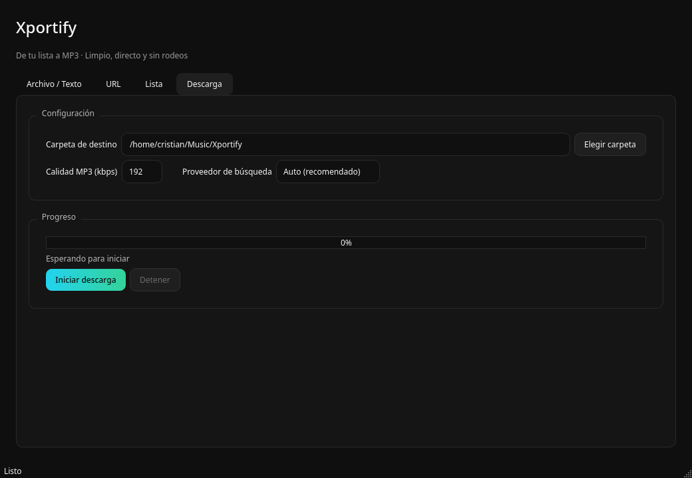

# Xportify

De tu lista a MP3. Una app de escritorio que convierte playlists de **Spotify, YouTube Music, SoundCloud y Bandcamp** —o un simple CSV/Excel— en archivos MP3 con metadatos.




## Por qué existe

SpotDL, Zotify y Spotube piden iniciar sesión con Spotify para casi todo. Xportify parte de otra idea: **tú ya tienes la lista, nosotros la descargamos**. Si quieres tus "Me gusta", los exportas con Exportify en un clic y Xportify hace el resto. Sin OAuth, sin tokens caducados, sin dramas.

## Características

- **Cuatro formas de entrada**
  - CSV / Excel / JSON exportado de Spotify (Exportify, Playlistation, TuneMyMusic…)
  - URL de playlist o álbum de Spotify (pública, sin login)
  - URL de YouTube / YouTube Music, SoundCloud o Bandcamp
  - Texto plano `Artista - Canción`, una por línea
- **Enlaces directos** a Exportify y Playlistation dentro de la app, para que conseguir el CSV no sea un misterio.
- **Búsqueda híbrida**: intenta primero YouTube Music (mejores coincidencias) y cae a YouTube si falla.
- **Descargas en segundo plano**: la ventana no se congela.
- **Metadatos** de título, artista y álbum en el MP3.
- **Reanudable**: omite canciones que ya existen.
- **Registro de fallidas** en `fallidas.txt`.
- **CLI incluida** para quien prefiera la terminal.

| Lista | Descarga |
|---|---|
|  |  |

## Requisitos

- Python 3.10+
- [ffmpeg](https://ffmpeg.org/) en el sistema

```bash
# Arch / Manjaro
sudo pacman -S ffmpeg
# Ubuntu / Debian
sudo apt install ffmpeg
# Fedora
sudo dnf install ffmpeg
# macOS
brew install ffmpeg
```

## Instalación

```bash
git clone https://github.com/crigutierrez-code/xportify.git
cd xportify
python -m venv .venv
source .venv/bin/activate   # Windows: .venv\Scripts\activate
pip install -r requirements.txt
```

## Uso

```bash
python main.py
```

O instálalo como paquete:

```bash
pip install -e .
xportify
```

### CLI

```bash
xportify-cli mi_playlist.csv -o ~/Música/playlist --calidad 320
xportify-cli "https://open.spotify.com/playlist/..." -o ~/Música
```

## Cómo conseguir tus "Me gusta"

1. Abre [watsonbox/Exportify](https://watsonbox.github.io/exportify/) (recomendado, open source) o [exportify.net](https://exportify.net/).
2. Inicia sesión con Spotify y elige **Liked Songs**.
3. Exporta a CSV.
4. Carga ese CSV en Xportify.

También hay enlaces a estos servicios dentro de la app, en la pestaña **Archivo / Texto**.

> La lista privada de "Me gusta" no se puede leer solo con una URL: Spotify no la expone públicamente. Por eso el flujo CSV sigue siendo el más fiable.

## Estructura

```
xportify/
├── src/xportify/
│   ├── core/
│   │   ├── parser.py      # CSV / Excel / JSON / texto
│   │   ├── spotify.py     # URLs de Spotify (embed público)
│   │   ├── sources.py     # YouTube, SoundCloud, Bandcamp (yt-dlp)
│   │   ├── search.py      # búsqueda YT Music / YouTube
│   │   └── downloader.py  # descarga + conversión + metadatos
│   ├── ui/
│   │   └── main_window.py # interfaz PySide6
│   ├── utils/
│   │   ├── ffmpeg.py
│   │   └── icon.py
│   ├── cli.py
│   └── main.py
├── assets/icon.svg
├── docs/
└── main.py
```

## Aviso legal

Xportify no aloja ni distribuye música. Descarga contenido desde fuentes públicas según los términos de cada servicio. Úsalo con contenido que tengas derecho a descargar.

## Licencia

MIT
