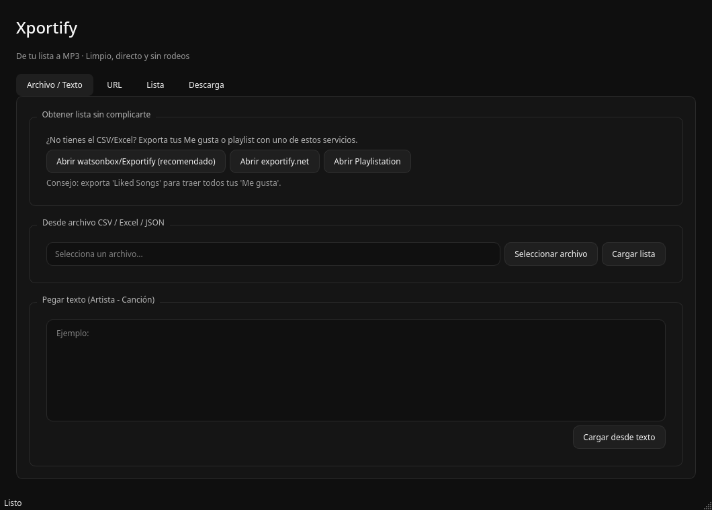
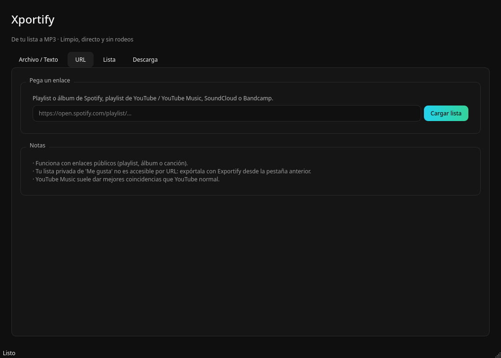
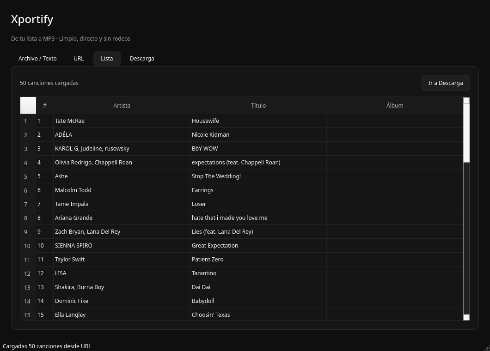
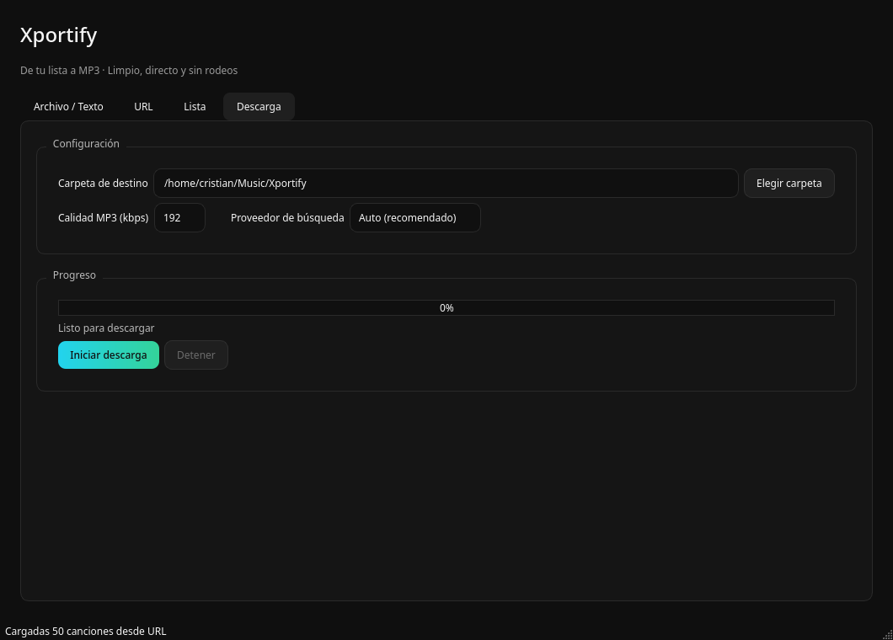

# Xportify


**De tu lista a MP3.** Convierte playlists de **Spotify, YouTube Music, SoundCloud y Bandcamp** (o un CSV/Excel) a archivos MP3 con metadatos, desde una app de escritorio limpia y directa.

[](https://github.com/crigutierrez-code/xportify/releases)
[](LICENSE)
[](https://www.python.org/)




| Lista | Descarga |
|---|---|
|  |  |

## Por qué existe

La gran mayoría de descargadores te obligan a iniciar sesión con Spotify. Xportify va por otro camino: **tú ya tienes la lista, nosotros la buscamos en YouTube/YouTube Music y la descargamos**. Si quieres tus *Liked Songs*, solo exportalos con Exportify en un clic y ábrelos desde la app. Sin OAuth, sin tokens que caduquen.

## Características

- **Múltiples formas de entrada** – CSV/Excel/JSON/TSV, URL pública de Spotify (playlist/álbum/pista), YouTube/YouTube Music, SoundCloud o Bandcamp, o pega `Artista - Canción` línea a línea.
- **Arrastrar y soltar** – Arrastra tu archivo directamente a la ventana.
- **Enlaces directos integrados** – Acceso rápido a [watsonbox/Exportify](https://watsonbox.github.io/exportify/) (recomendado), [exportify.net](https://exportify.net/) y [Playlistation](https://playlistation.com/) para sacar tus *Liked Songs*.
- **Búsqueda híbrida** – Prioriza YouTube Music para mayor precisión y usa YouTube como fallback.
- **Seguimiento en tiempo real** – Columna `Estado` por canción (`Pendiente`, `Buscando`, `Descargando`, `Listo`, `Omitida`, `Error`).
- **Descargas en segundo plano** – La interfaz nunca se bloquea.
- **Metadatos** – Título, artista y álbum embebidos en el MP3.
- **Reanudable** – Omite archivos ya existentes.
- **Guardar/Exportar lista** – Guarda lo que tengas cargado en CSV/JSON/Excel.
- **Abrir carpeta** – Abre directamente la carpeta de destino desde la app.
- **Configuración persistente** – Recuerda última carpeta, calidad y proveedor.
- **Cierre seguro** – Te avisa si hay una descarga en curso al cerrar.
- **CLI incluida** – `xportify-cli` para usarlo desde terminal.
- **Icono oficial** – Con el logo diseñado específicamente para Xportify.

## Descarga

### Opción 1: Binario listo para usar (Linux) — Más rápido

Descarga el `.tar.gz` desde [Releases](https://github.com/crigutierrez-code/xportify/releases), extráelo y ejecútalo.

```bash
tar xzf Xportify-Linux-x86_64.tar.gz
cd Xportify
./Xportify
```

También puedes usar `Xportify.desktop` para abrirlo con doble clic.

### Opción 2: Desde código fuente (Linux, Windows, macOS)

Necesitarás [Python 3.10+](https://www.python.org/) y [ffmpeg](https://ffmpeg.org/).

```bash
git clone https://github.com/crigutierrez-code/xportify.git
cd xportify
python -m venv .venv
# Linux/macOS
./.venv/bin/pip install -r requirements.txt
./.venv/bin/python main.py
# Windows (PowerShell)
# .\.venv\Scripts\pip install -r requirements.txt
# .\.venv\Scripts\python main.py
```

También puedes crear un lanzador/`.desktop` con los archivos incluidos (`xportify-launcher.sh`, `Xportify.desktop`).

### Opción 3: Instalable en modo desarrollo

```bash
pip install -e .
xportify
```

## Requisitos del sistema

- **Sistema**: Linux, Windows o macOS
- **FFmpeg**: Obligatorio para convertir a MP3

```bash
# Arch / Manjaro
sudo pacman -S ffmpeg

# Ubuntu / Debian
sudo apt install ffmpeg

# Fedora
sudo dnf install ffmpeg

# macOS (Homebrew)
brew install ffmpeg

# Windows
# Descarga desde https://www.gyan.dev/ffmpeg/builds/ y añade al PATH
```

## Uso rápido

1. **Desde archivo** – Ve a `Archivo / Texto` → Selecciona tu CSV/Excel exportado con Exportify → `Cargar lista`
2. **Desde URL** – Ve a `URL` → Pega un enlace público de Spotify/YouTube/YouTube Music/SoundCloud/Bandcamp → `Cargar lista`
3. **Pegar texto** – Ve a `Archivo / Texto` → Pega `Artista - Canción` → `Cargar desde texto`
4. **Descargar** – Ve a `Lista` para revisar → `Descarga` elige carpeta/calidad/proveedor → `Iniciar descarga`

## Cómo conseguir tus "Me gusta" (Liked Songs)

Spotify no expone las canciones que te gustan por una URL pública. El método más directo y fiable es exportarlas con **Exportify**:

1. Abre [watsonbox.github.io/exportify](https://watsonbox.github.io/exportify/) (recomendado, open source)
2. Inicia sesión con Spotify
3. Selecciona `Liked Songs` y exporta a `.CSV`
4. Carga ese CSV en Xportify

Desde la pestaña `Archivo / Texto` tienes los botones directos para abrir estos servicios.

## CLI

```bash
xportify-cli mi_playlist.csv -o ~/Música/Xportify --calidad 320
xportify-cli "https://open.spotify.com/playlist/..." -o ~/Música/Xportify --proveedor ytmusic
```

## Estructura del proyecto

```text
xportify/
├── assets/           # Iconos oficiales (PNG/ICO/ICNS/SVG)
├── docs/             # Capturas de pantalla
├── src/xportify/
│   ├── core/         # parser, spotify, sources, search, downloader
│   ├── ui/           # Interfaz PySide6
│   ├── utils/        # config, ffmpeg, icon
│   ├── cli.py
│   └── main.py
├── main.py
├── Xportify.desktop
├── xportify-launcher.sh
└── pyproject.toml
```

## Aviso legal

Xportify no aloja, distribuye ni provee contenido musical. Descarga únicamente material desde fuentes públicas y respeta los derechos de autor y los términos de servicio de cada plataforma. Úsalo bajo tu propia responsabilidad.

## Licencia

[MIT](LICENSE) © 2026 Cristian
